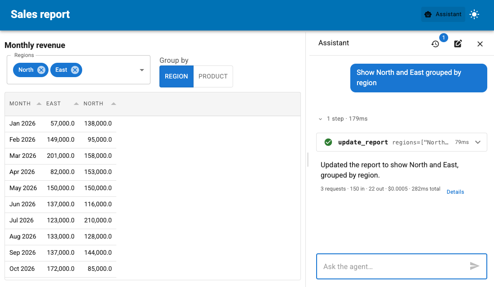

# panel-agents

Panel components for building user interfaces for AI agents: a chat with tool-call cards, versioned artifacts and documents, human-in-the-loop approvals, actions on the page the user is looking at, traces and session replay.

Agent frameworks are connected through adapters that translate their output into a small set of normalized events, modelled on the [AG-UI protocol](https://docs.ag-ui.com). The components bind to a reactive `RunState` built from those events, so the same UI works live, against a recorded session, or with any framework that has an adapter. The pydantic-ai adapter ships with the package.

```bash
pip install "panel-agents[pydantic-ai]"
```

A chat for a pydantic-ai agent, docked beside an existing app, with inline approvals and a versioned artifact pane:

```python
import panel as pn
from panel_agents import AgentDrawer, ApprovalPolicy
from panel_agents.adapters.pydantic_ai import AgentRunner

runner = AgentRunner(agent, deps=deps, approval_policy=ApprovalPolicy(["save_*", "delete_*"]))
drawer = AgentDrawer(runner, main=my_app)
pn.ui.Page(title="My app", header=[drawer.toggle], main=[drawer]).servable()
```



Every session can be recorded and replayed with the same components:

```python
from panel_agents import Recorder, load_state

with Recorder(runner.state, "runs/session.jsonl"):
    await runner.run("Summarize last month's sales")

replayed = load_state("runs/session.jsonl")
```

## Guides

The documentation is at [panel-extensions.github.io/panel-agents](https://panel-extensions.github.io/panel-agents), with a getting-started tutorial, the guides below and the API reference.

- [Arrange the chat](docs/how-to/chat.md): message placement and the document layout of `AgentChat`.
- [Dock an agent beside an existing app](docs/how-to/agent-drawer.md) with `AgentDrawer`.
- [Require approval for tool calls](docs/how-to/approvals.md) with `ApprovalPolicy`.
- [Edit documents with versions you can apply and revert](docs/how-to/document-artifacts.md), with semantic diffs.
- [Let the agent act on the page](docs/how-to/ui-actions.md) with an `ActionRegistry`.
- [Serve an agent's tools over MCP](docs/how-to/mcp.md) with the `mcp` extra.
- [Show model calls and run traces](docs/how-to/model-calls.md) with `RunTrace` and `SpanView`.
- [Trace and replay model calls](docs/how-to/model-traces.md) with a `ModelTraceRecorder` and a `Cassette`.
- [Security](docs/how-to/security.md): what panel-agents does about prompt injection in rendered output and approvals.
- [API reference](docs/reference/api.md): everything public, by module.
- [Release notes](docs/releases.md).

## Examples

- `examples/drawer_app.py`: an agent docked beside a sales report, editing it as a document, filtering it through a front-end action and asking before it exports.
- `examples/sql_analyst/`: a data-analysis agent over DuckDB, a replay viewer for its recordings and an MCP server for its tools.
- `examples/approval_demo.py`, `examples/artifacts_demo.py` and `examples/chat_replay.py`: the approval, artifact and chat components on synthetic events, without a model.

## Compatibility

panel-agents follows semantic versioning for the names listed in the [API reference](docs/reference/api.md). Names and modules starting with an underscore are private and may change in any release, and recordings written by a release can be read by later releases of the same major version.
