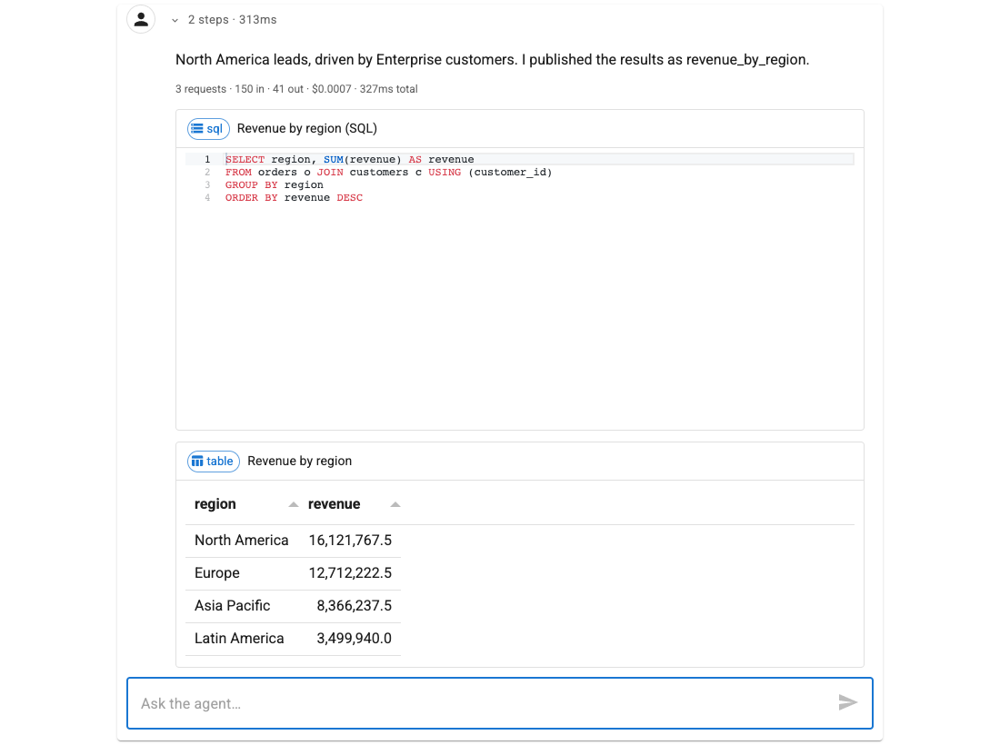

# Arrange the chat

`AgentChat` shows the `RunState` of a runner as a chat feed and passes what the person types to `runner.run`. Its parameters decide where messages sit, what each message shows and whether the feed reads as a conversation or as a document. In an `AgentDrawer`, pass them through `chat_params`.

## Place the messages

By default the person's messages sit on the right as bubbles and the agent's on the left. `user_placement` moves the person's messages, and `message_params` are passed to every `ChatMessage` the chat builds:

```python
import panel as pn

from panel_agents import AgentChat

chat = AgentChat(
    runner=runner,
    user_placement="left",
    message_params={"show_avatar": False},
)

pn.ui.Page(title="Ask an agent", main=[chat]).servable()
```

`{"show_avatar": False, "show_user": False}` leaves out who sent each message. The chat keeps control of `visible`, since it hides and shows messages as a run streams and its steps fold, and adds any `css_classes` you give to its own. Changing either parameter builds the messages already shown again.

The person's messages are the ones shown under `user` ("User" by default), and the agent's are shown under the run's agent name, or `assistant` when the run has none. `avatars` maps those names to an emoji, text or image URL, e.g. `{"User": "🙂"}`, and `placeholder` sets the input's placeholder.

## Read the chat as a document

With `layout="document"` the feed is a wide centred column with every message on the left, and the artifacts a run published render inline as `ArtifactCell`s in a row after the run's messages. This suits an agent whose answers are mostly tables, charts or reports:

```python
chat = AgentChat(
    runner=runner,
    layout="document",
    inline_artifacts=lambda artifact: artifact.kind == "table",
    cell_renderer=lambda artifact: pn.widgets.Tabulator(artifact.value, disabled=True, show_index=False),
    max_cells=4,
)
```



`layout` is set once, when the chat is created. `inline_artifacts` chooses which artifacts get a cell; by default every artifact that is not a [document](document-artifacts.md), since a document already lives in the app. The tool calls that published an inline artifact need no chip of their own and fold into the run's step group. `cell_renderer` renders a cell's body, by default with the renderers registered through `register_renderer`. A cell shows the latest version and renders again when a new one is published. A run that publishes more than `max_cells` artifacts shows the rest behind a "Show more" button. `chat.cells` maps artifact ids to the cells built so far.

`user_placement="right"` puts the person's messages back on the right as bubbles in the document layout too. Cells can offer actions such as "Add to dashboard", see [Offer actions on artifacts](ui-actions.md#offer-actions-on-artifacts).

## Send text from code

`await chat.submit(text)` sends text as if the person had typed it, for example from a list of example questions, and writes any [mentions](agent-drawer.md#hand-an-item-over-to-the-agent) in the input at its start. It does nothing while a run is in progress.

```python
button = pn.ui.Button(label="Which region sold most?", variant="text")


async def ask(event):
    await chat.submit(button.label)


button.on_click(ask)
```

Without a runner, `callback` receives the submitted text instead, and the chat adds it to the state as a user message first unless `add_user_message=False`. `AgentChat(state, readonly=True)` shows a state without an input, for example one replayed with `load_state`.
