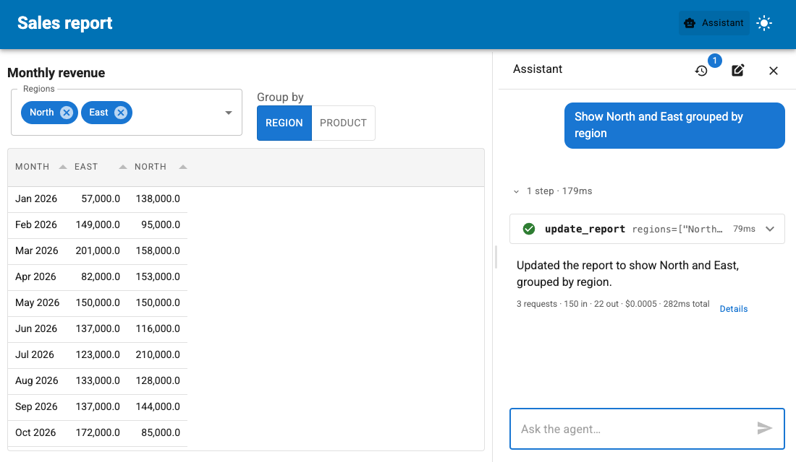

# panel-agents

panel-agents gives [Panel](https://panel.holoviz.org) apps the pieces an AI agent's user interface needs: a streaming chat with tool-call cards, versioned artifacts and documents the agent edits, human-in-the-loop approvals, typed actions on the page the user is looking at, and traces you can record and replay.

The components never talk to an agent framework directly. An adapter translates the framework's output into a small set of normalized events, modelled on the [AG-UI protocol](https://docs.ag-ui.com), and the components bind to a reactive `RunState` built from those events. That is why the same UI works during a live run, against a recorded session, or with any framework that has an adapter. The pydantic-ai adapter ships with the package.



## Install

```bash
pip install "panel-agents[pydantic-ai]"
```

The `mcp` extra adds `panel_agents.mcp` for serving an agent's tools over MCP, and the `examples` extra installs what the example apps need.

## A minimal app

A chat with a pydantic-ai agent, served with `panel serve app.py`:

```python
import panel as pn
from pydantic_ai import Agent

from panel_agents import AgentChat
from panel_agents.adapters.pydantic_ai import AgentRunner

agent = Agent("anthropic:claude-sonnet-5-5", instructions="Answer briefly.")
runner = AgentRunner(agent)

pn.ui.Page(title="Ask an agent", main=[AgentChat(runner=runner)]).servable()
```

From there, [Getting started](getting-started.md) adds a tool and docks the agent beside an existing app with `AgentDrawer`.

## Where to go next

- [Getting started](getting-started.md) walks through a chat and a drawer in a few minutes.
- The how-to guides cover [arranging the chat](how-to/chat.md), [the agent drawer](how-to/agent-drawer.md), [approvals](how-to/approvals.md), [document artifacts](how-to/document-artifacts.md), [front-end actions](how-to/ui-actions.md), [MCP](how-to/mcp.md), [model calls and run traces](how-to/model-calls.md), [model traces and replay](how-to/model-traces.md) and [security](how-to/security.md).
- [Examples](examples.md) describes the runnable apps in the repository.
- The [API overview](reference/api.md) lists everything public, and [API by module](reference/modules.md) has the docstrings.

## Compatibility

panel-agents follows semantic versioning for the names listed in the [API overview](reference/api.md). Names and modules starting with an underscore are private and may change in any release, and recordings written by a release can be read by later releases of the same major version.
